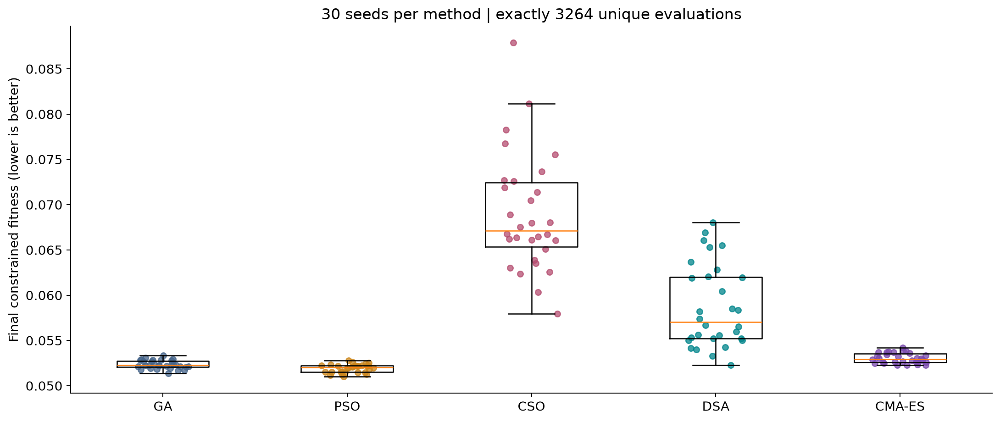
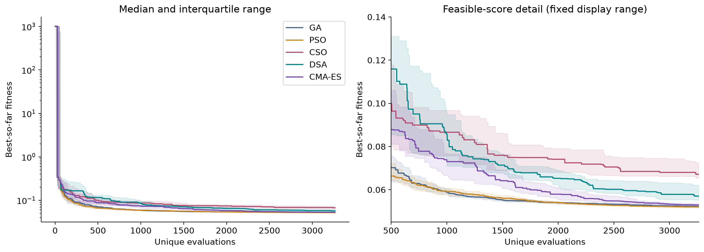
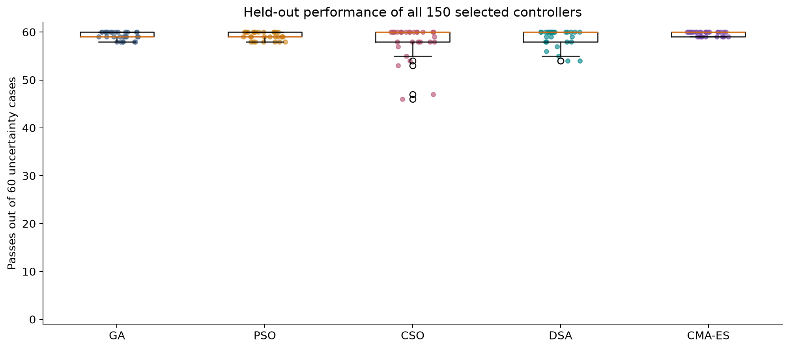
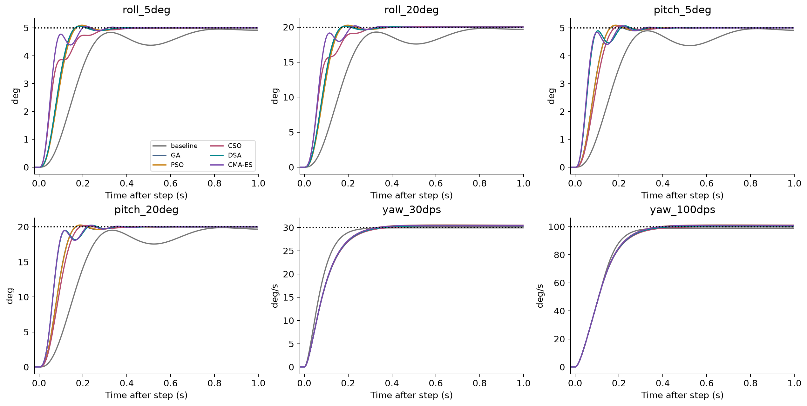

# Five-method nominal benchmark

**Author: Mohammad ALbaraj** · [Project](../../README.md) · [Methodology](../../docs/METHODOLOGY.md)

## Design

Compare GA, PSO, CSO, DSA, and active full-covariance CMA-ES on the same nonlinear attitude model. Each method uses 30 paired seeds (11,29,47,101–127) and exactly 3,264 unique objective evaluations per seed, including the shared 64 initial candidates and source baseline. There are 150 main runs and 489,600 unique evaluations.

Nominal training uses six commands: roll/pitch 5 and 20 degrees, yaw rate 30 and 100 degrees/s. This represents 2,937,600 training-scenario simulations in completed searches, excluding validation and other overhead.

The strict-budget driver in [benchmark.py](benchmark.py) truncates final batches, caches repeated points, retains the best archive, and schedules GA mutation/PSO inertia by consumed budget. Configured iteration counts inherited from single-method studies do not override this stopping rule. [results/contract.json](results/contract.json) is the frozen experiment contract.

## Saved results

| Method | Best | Median | Mean | Sample SD | Feasible runs |
| --- | --- | --- | --- | --- | --- |
| GA | 0.051359683 | 0.052263125 | 0.052345923 | 0.00047155332 | 30/30 |
| PSO | 0.051033503 | 0.052025843 | 0.051917325 | 0.00046374851 | 30/30 |
| CSO | 0.057978346 | 0.067147048 | 0.068945826 | 0.006431857 | 30/30 |
| DSA | 0.052268007 | 0.057028331 | 0.058708589 | 0.0045881442 | 30/30 |
| CMA-ES | 0.05226415 | 0.052958785 | 0.053037539 | 0.00056362 | 30/30 |

Source: [summary.csv](results/summary.csv). PSO has the lowest median in this five-method dataset. This is a single-problem result; no universal ranking is implied.

## Validation and limits

Every seed winner is assessed on deterministic hold-outs, 60 single-axis uncertainty cases and 30 combined-axis stress cases from this nominal benchmark. This is distinct from the later robustness benchmark's 444-case suite. Training-selected best/median representatives and exported gains are retained. [validation_summary.csv](results/validation_summary.csv) and [robustness_summary.csv](results/robustness_summary.csv) contain the validation summaries.

## Statistics

[statistics.json](results/statistics.json) records the Friedman permutation design and bootstrap settings. Paired tests and confidence intervals concern seed variability on this fixed model. Holm correction applies to paired comparison families; intervals are descriptive. Never mix these 30-seed results with the earlier three-seed iteration-based runs.

## Reproduction

Run from this folder:

```powershell
python -m venv .venv
.\.venv\Scripts\python.exe -m pip install -r requirements-lock.txt
.\.venv\Scripts\python.exe -m unittest test_budget test_study
.\.venv\Scripts\python.exe benchmark.py --resume
```

The supplied results are completed runs. Resume checks require the original configuration and source hashes. Use a separate clean copy for a new experiment and do not mix outputs from changed code with this archive. Analysis and report scripts can create local outputs; PDF/HTML reports are not published in the repository.

## Data and figures

- [runs/](results/runs/): run JSON and NPZ evaluation ledgers.
- [exports/](results/exports/): selected gains and exact controller maps.
- [validation/](results/validation/): scenario-level records.
- [verification.json](results/verification.json): historical audit record, distinct from current packaging checks.

### 01 fitness distributions



### 02 convergence



### 03 robustness



### 04 best responses



See [data provenance](../../docs/DATA.md) for verification scope and [CITATION.cff](../../CITATION.cff) to cite this project.
