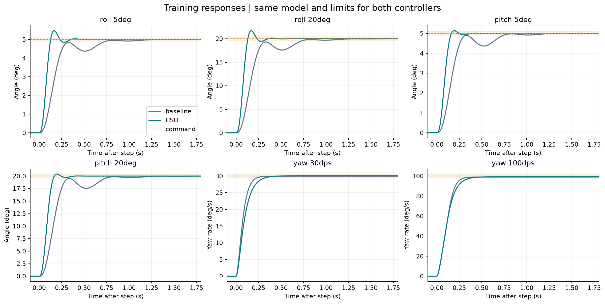
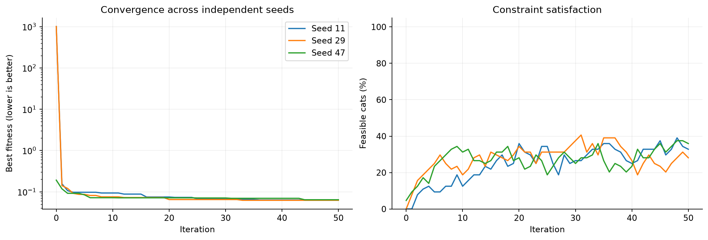
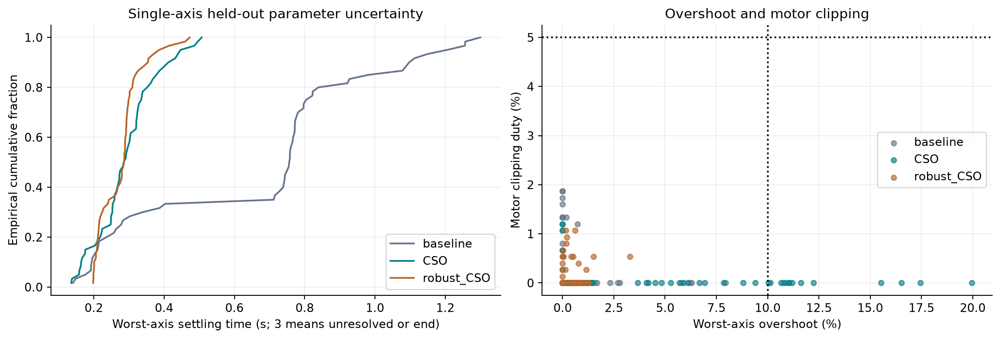

# Cat Swarm Optimization (CSO) for quadrotor controller tuning

**Author: Mohammad ALbaraj** · [Project overview](../../README.md) · [Shared model and objective](../../docs/METHODOLOGY.md)

## Purpose

Tune eight bounded roll/pitch and yaw-rate controller parameters offline. The optimizer changes gains; it does not change the plant equations, controller structure, or constraints. Lower constrained fitness is better within the same training regime.

## How this implementation works

This implementation alternates seeking and tracing modes and keeps a best archive across every evaluated trial, including trials not selected as a cat's next position.

1. Initialize 64 cats in normalized log-gain space and include the original controller.
2. Randomly assign 13 cats to tracing each iteration (round(64 × 0.2)); the others seek.
3. A seeking cat considers five candidates, including its current position. Each new copy multiplies four randomly chosen coordinates by 1 ± 0.2 and clips to [0, 1].
4. Select among seeking copies with probabilities proportional to `worst_fitness - candidate_fitness`; use uniform probabilities if all scores tie.
5. A tracing cat updates `v = v + 2*r*(archive_best-x)` and then moves. Velocity is capped at ±0.2, with boundary damping 0.5.
6. Reassign modes and repeat for 50 updates.

Seeking creates multiple evaluations per cat. Equal iteration counts therefore do not give equal computation across algorithms. CSO tracing does not use PSO's personal-best term or decreasing inertia.

Read [cso.py](cso.py) for the implemented update rules, [config.json](config.json) for settings, and [study.py](study.py) for objective evaluation.

## Original study settings

| Setting | Value |
| --- | --- |
| seeds | `[11, 29, 47]` |
| workers | `4` |
| swarm_size | `64` |
| iterations | `50` |
| velocity_limit | `0.2` |
| initial_velocity_limit | `0.1` |
| boundary_damping | `0.5` |
| seeking_memory_pool | `5` |
| seeking_range | `0.2` |
| dimensions_to_change_fraction | `0.5` |
| self_position_considering | `true` |
| mixture_ratio | `0.2` |
| tracing_coefficient | `2.0` |
| comparison_evaluation_budget | `3264` |

The original study uses seeds 11, 29, and 47. Separate robust searches and exploratory sensitivity runs are additional experiments. Their results are not pooled into the nominal main runs.

## Saved original-study results

| Seed | Final training fitness | Unique evaluations |
| --- | --- | --- |
| 11 | 0.062374031 | 10891 |
| 29 | 0.062168299 | 10884 |
| 47 | 0.064141336 | 10890 |

Selected controller: **best training fitness across seeds; seed 29**. Its training fitness is **0.062168299**; the source baseline is **1011.6168**, which includes infeasibility penalties. The difference is not a percentage improvement in settling time.

| Gain | Selected value |
| --- | --- |
| roll_outer_K | 13.806324 |
| roll_inner_Kp_equivalent | 0.068013988 |
| roll_inner_Ki_equivalent | 0.00010618597 |
| pitch_outer_K | 11.470004 |
| pitch_inner_Kp_equivalent | 0.068013988 |
| pitch_inner_Ki_equivalent | 0.00031090791 |
| yaw_Kp | 0.38616527 |
| yaw_Ki | 0.028474686 |

Exact discrete coefficients are in [best_gains.json](results/best_gains.json) and [SIMULINK_PARAMETER_MAP.txt](results/SIMULINK_PARAMETER_MAP.txt). Roll/pitch equivalent Kp/Ki values must not be substituted blindly into an ideal PI block; retain the exported pole and numerator.

## Separate 30-seed, equal-budget results

These numbers come from the later benchmark: 3,264 unique evaluations per seed, including initialization. They are not the three-seed results above.

| Regime | Best | Median | Mean | Sample SD | Training-feasible runs |
| --- | --- | --- | --- | --- | --- |
| Nominal | 0.057978346 | 0.067147048 | 0.068945826 | 0.006431857 | 30/30 |
| Robust | 0.075365308 | 0.085949108 | 0.086491404 | 0.0068379638 | 30/30 |

Sources: [nominal benchmark](../../all%20work/30%20seed%20equal%20budget%20study/README.md) and [robustness benchmark](../../all%20work/robustness%2030%20seed%20study/README.md). Nominal and robust fitness use different training scenario sets, so their numerical magnitudes are not directly interchangeable.

## Run and inspect

From this folder in PowerShell:

```powershell
python -m venv .venv
.\.venv\Scripts\python.exe -m pip install -r requirements-lock.txt
.\.venv\Scripts\python.exe -m unittest test_study test_cso
.\.venv\Scripts\python.exe run_study.py --mode quick --output results_quick
```

Use `--mode full --output results_new` for a fresh full run. Keep the distributed `results/` as the archived experiment. Quick mode is still a simulation study, not an instant test. Comparison reference snapshots are included where required. Report-generation code may create local HTML; rendered reports are excluded from version control.

## Result files

| Path | Meaning |
| --- | --- |
| [results/metrics.csv](results/metrics.csv) | Per-controller, per-scenario response metrics and feasibility |
| [results/monte_carlo.csv](results/monte_carlo.csv) | Single-axis uncertainty and combined-axis stress cases |
| [results/robust_gains.json](results/robust_gains.json) | Separate uncertainty-focused candidate |
| [results/numerical_convergence.csv](results/numerical_convergence.csv) | Integration-step sensitivity |
| [results/gain_sensitivity.csv](results/gain_sensitivity.csv) | One-gain-at-a-time perturbations |
| [results/](results/) | Run JSON, iteration histories, candidate data, traces, and historical verification |

## Figures







### Complete figure index

- [01 step responses](results/plots/01_step_responses.png)
- [02 cso iterations](results/plots/02_cso_iterations.png)
- [03 coupled and saturation](results/plots/03_coupled_and_saturation.png)
- [04 inner loops](results/plots/04_inner_loops.png)
- [05 robustness](results/plots/05_robustness.png)
- [06 gain sensitivity](results/plots/06_gain_sensitivity.png)
- [07 metric comparison](results/plots/07_metric_comparison.png)
- [08 fitness components](results/plots/08_fitness_components.png)
- [09 robust candidate](results/plots/09_robust_candidate.png)
- [10 method responses](results/plots/10_method_responses.png)
- [11 evaluation comparison](results/plots/11_evaluation_comparison.png)

## Limits and provenance

The files are saved simulation outputs from the supplied project, not new flight tests. Packaging checks and unit tests do not independently rerun the full optimization campaigns. The six newer methods received a development grid that the original five did not; an eleven-method comparison is exploratory even with equal final budgets. Controller timing is assumed at 1 ms and mixer timing at 4 ms. Negative motor speeds are rejected under the preserved source motor equation. Position/altitude control and hardware robustness are outside this study.

See [shared methodology](../../docs/METHODOLOGY.md) and [data provenance](../../docs/DATA.md). Please cite Mohammad ALbaraj using [CITATION.cff](../../CITATION.cff). No reuse license has yet been selected.
