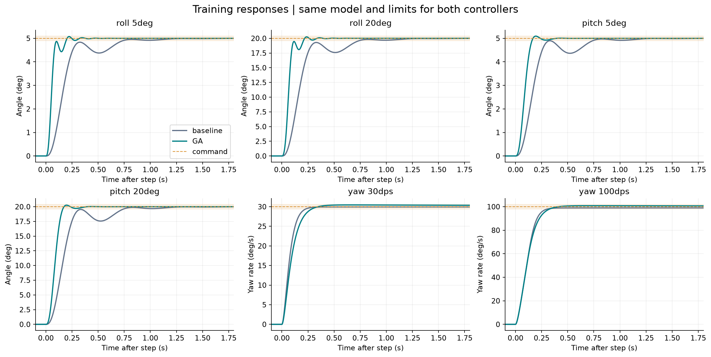
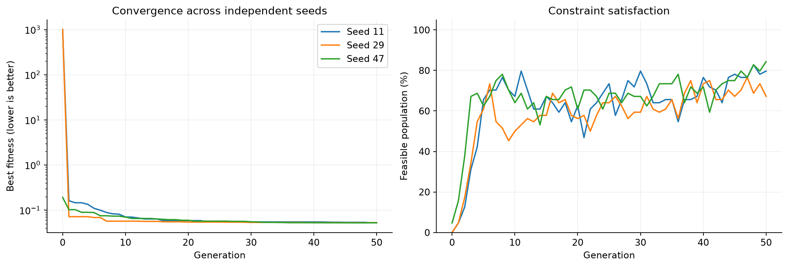
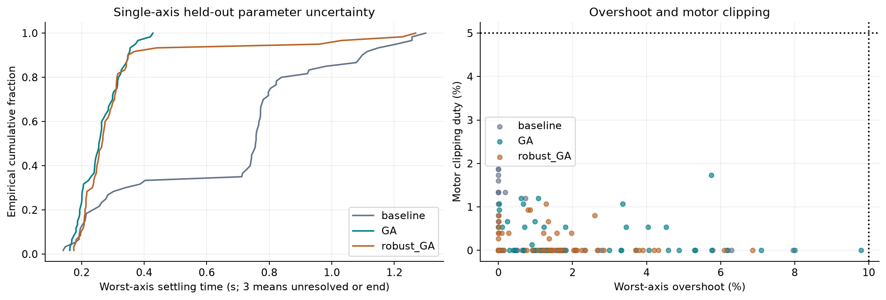

# Genetic Algorithm (GA) for quadrotor controller tuning

**Author: Mohammad ALbaraj** · [Project overview](../../README.md) · [Shared model and objective](../../docs/METHODOLOGY.md)

## Purpose

Tune eight bounded roll/pitch and yaw-rate controller parameters offline. The optimizer changes gains; it does not change the plant equations, controller structure, or constraints. Lower constrained fitness is better within the same training regime.

## How this implementation works

The real-coded GA evolves a population of candidate gain vectors. Each coordinate is a normalized logarithmic gain.

1. Create 64 stratified random candidates and insert the original controller.
2. Evaluate the constrained objective, sort the population, and retain four elites.
3. Select parents using tournaments of three candidates.
4. With probability 0.9, blend parents using coordinate-wise weights drawn from [-0.15, 1.15].
5. Mutate each coordinate with probability 0.25 using Gaussian noise. Clip trial coordinates to [0, 1]. Random immigrants are proposed with probability 0.08.
6. Repeat for 50 generations; mutation sigma decreases from 0.14 to 0.035. Return the best retained candidate.

Elitism preserves good solutions while mutation and immigrants explore alternatives. In the separate strict-budget benchmark, the mutation schedule follows evaluation-budget progress rather than generation number.

Read [study.py](study.py) for the implemented update rules, [config.json](config.json) for settings, and [study.py](study.py) for objective evaluation.

## Original study settings

| Setting | Value |
| --- | --- |
| population | `64` |
| generations | `50` |
| seeds | `[11, 29, 47]` |
| elitism | `4` |
| tournament_size | `3` |
| crossover_probability | `0.9` |
| mutation_probability_per_gene | `0.25` |
| mutation_sigma_start | `0.14` |
| mutation_sigma_end | `0.035` |
| random_immigrant_fraction | `0.08` |
| workers | `4` |

The original study uses seeds 11, 29, and 47. Separate robust searches and exploratory sensitivity runs are additional experiments. Their results are not pooled into the nominal main runs.

## Saved original-study results

| Seed | Final training fitness | Unique evaluations |
| --- | --- | --- |
| 11 | 0.052787993 | 3030 |
| 29 | 0.052633873 | 3035 |
| 47 | 0.052265086 | 3024 |

Selected controller: **best training fitness across seeds; seed 47**. Its training fitness is **0.052265086**; the source baseline is **1011.6168**, which includes infeasibility penalties. The difference is not a percentage improvement in settling time.

| Gain | Selected value |
| --- | --- |
| roll_outer_K | 16.12697 |
| roll_inner_Kp_equivalent | 0.15005147 |
| roll_inner_Ki_equivalent | 0.0065711152 |
| pitch_outer_K | 11.309904 |
| pitch_inner_Kp_equivalent | 0.06902442 |
| pitch_inner_Ki_equivalent | 0.003334825 |
| yaw_Kp | 0.38535376 |
| yaw_Ki | 0.082129758 |

Exact discrete coefficients are in [best_gains.json](results/best_gains.json) and [SIMULINK_PARAMETER_MAP.txt](results/SIMULINK_PARAMETER_MAP.txt). Roll/pitch equivalent Kp/Ki values must not be substituted blindly into an ideal PI block; retain the exported pole and numerator.

## Separate 30-seed, equal-budget results

These numbers come from the later benchmark: 3,264 unique evaluations per seed, including initialization. They are not the three-seed results above.

| Regime | Best | Median | Mean | Sample SD | Training-feasible runs |
| --- | --- | --- | --- | --- | --- |
| Nominal | 0.051359683 | 0.052263125 | 0.052345923 | 0.00047155332 | 30/30 |
| Robust | 0.065731361 | 0.066991874 | 0.06706489 | 0.00096806604 | 30/30 |

Sources: [nominal benchmark](../../all%20work/30%20seed%20equal%20budget%20study/README.md) and [robustness benchmark](../../all%20work/robustness%2030%20seed%20study/README.md). Nominal and robust fitness use different training scenario sets, so their numerical magnitudes are not directly interchangeable.

## Run and inspect

From this folder in PowerShell:

```powershell
python -m venv .venv
.\.venv\Scripts\python.exe -m pip install -r requirements-lock.txt
.\.venv\Scripts\python.exe -m unittest test_study
.\.venv\Scripts\python.exe run_study.py --mode quick --output results_quick
```

Use `--mode full --output results_new` for a fresh full run. Keep the distributed `results/` as the archived experiment. Quick mode is still a simulation study, not an instant test. Comparison reference snapshots are included where required. Report-generation code may create local HTML; rendered reports are excluded from version control.

## Result files

| Path | Meaning |
| --- | --- |
| [results/metrics.csv](results/metrics.csv) | Per-controller, per-scenario response metrics and feasibility |
| [results/monte_carlo.csv](results/monte_carlo.csv) | Single-axis uncertainty and combined-axis stress cases |
| [results/robust_gains.json](results/robust_gains.json) | Separate uncertainty-focused candidate |
| [results/numerical_convergence.csv](results/numerical_convergence.csv) | Integration-step sensitivity |
| [results/gain_sensitivity.csv](results/gain_sensitivity.csv) | One-gain-at-a-time perturbations |
| [results/](results/) | Run JSON, iteration histories, candidate data, traces, and historical verification |

## Figures







### Complete figure index

- [01 step responses](results/plots/01_step_responses.png)
- [02 ga iterations](results/plots/02_ga_iterations.png)
- [03 coupled and saturation](results/plots/03_coupled_and_saturation.png)
- [04 inner loops](results/plots/04_inner_loops.png)
- [05 robustness](results/plots/05_robustness.png)
- [06 gain sensitivity](results/plots/06_gain_sensitivity.png)
- [07 metric comparison](results/plots/07_metric_comparison.png)
- [08 fitness components](results/plots/08_fitness_components.png)
- [09 robust candidate](results/plots/09_robust_candidate.png)

## Limits and provenance

The files are saved simulation outputs from the supplied project, not new flight tests. Packaging checks and unit tests do not independently rerun the full optimization campaigns. The six newer methods received a development grid that the original five did not; an eleven-method comparison is exploratory even with equal final budgets. Controller timing is assumed at 1 ms and mixer timing at 4 ms. Negative motor speeds are rejected under the preserved source motor equation. Position/altitude control and hardware robustness are outside this study.

See [shared methodology](../../docs/METHODOLOGY.md) and [data provenance](../../docs/DATA.md). Please cite Mohammad ALbaraj using [CITATION.cff](../../CITATION.cff). No reuse license has yet been selected.
