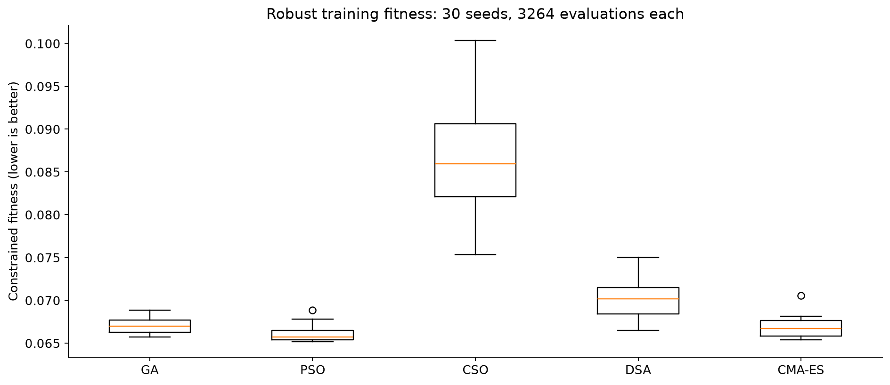
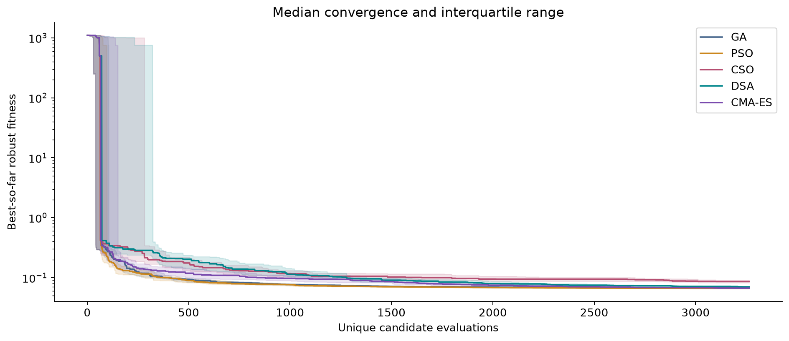
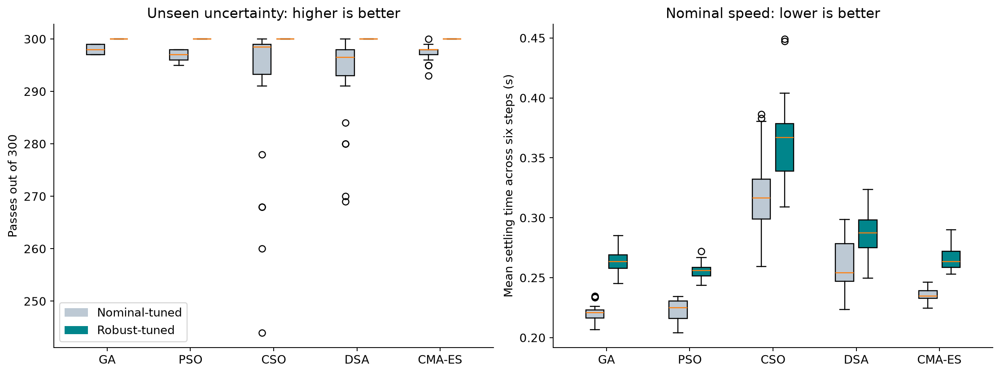
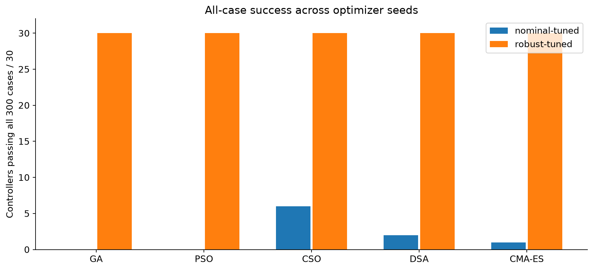
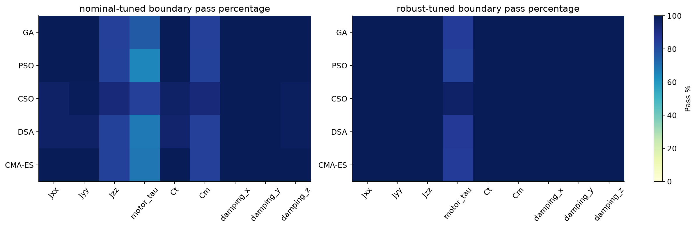
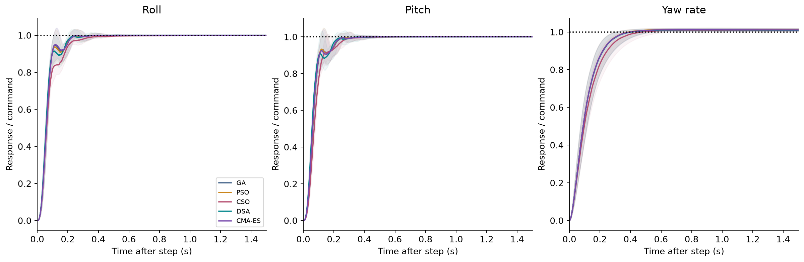

# Five-method robustness benchmark

**Author: Mohammad ALbaraj** · [Project](../../README.md) · [Methodology](../../docs/METHODOLOGY.md)

## Design

Compare GA, PSO, CSO, DSA, and active full-covariance CMA-ES on the same nonlinear attitude model. Each method uses 30 paired seeds (11,29,47,101–127) and exactly 3,264 unique objective evaluations per seed, including the shared 64 initial candidates and source baseline. There are 150 main runs and 489,600 unique evaluations.

Robust training uses 30 scenarios: six nominal commands and three commands on each of eight uncertain plants. This represents 14,688,000 training-scenario simulations in the completed searches, excluding warm-ups and validation.

The strict-budget driver in [benchmark.py](benchmark.py) truncates final batches, caches repeated points, retains the best archive, and schedules GA mutation/PSO inertia by consumed budget. Configured iteration counts inherited from single-method studies do not override this stopping rule. [results/contract.json](results/contract.json) is the frozen experiment contract.

## Saved results

| Method | Best | Median | Mean | Sample SD | Feasible runs |
| --- | --- | --- | --- | --- | --- |
| GA | 0.065731361 | 0.066991874 | 0.06706489 | 0.00096806604 | 30/30 |
| PSO | 0.065152582 | 0.065736838 | 0.066124861 | 0.00093294274 | 30/30 |
| CSO | 0.075365308 | 0.085949108 | 0.086491404 | 0.0068379638 | 30/30 |
| DSA | 0.066503257 | 0.070202619 | 0.070040764 | 0.0023270642 | 30/30 |
| CMA-ES | 0.065400499 | 0.066696075 | 0.06679798 | 0.0011446262 | 30/30 |

Source: [robust_fitness_summary.csv](results/robust_fitness_summary.csv). PSO has the lowest median in this five-method dataset. This is a single-problem result; no universal ranking is implied.

## Validation and limits

The saved robust-tuned controllers all pass the 300 random single-axis cases, while all fail the 90 combined-axis stress cases. Robust tuning trades nominal speed for sampled robustness. Best/median representatives receive 1,536 joint-boundary checks; those representative-specific findings do not apply automatically to every seed.

The archive also validates nominal-tuned reference controllers, so validation files can include more controllers than the 150 robust searches. [validation_summary.csv](results/validation_summary.csv), [corner_validation_summary.csv](results/corner_validation_summary.csv), and [nominal_vs_robust.csv](results/nominal_vs_robust.csv) keep those distinctions explicit.

## Statistics

[statistics.json](results/statistics.json) records the Friedman permutation design and bootstrap settings. Paired tests and confidence intervals concern seed variability on this fixed model. Holm correction applies to paired comparison families; intervals are descriptive. Never mix these 30-seed results with the earlier three-seed iteration-based runs.

## Reproduction

Run from this folder:

```powershell
python -m venv .venv
.\.venv\Scripts\python.exe -m pip install -r requirements-lock.txt
.\.venv\Scripts\python.exe -m unittest test_budget test_study test_robust
.\.venv\Scripts\python.exe run_robust.py --processes 3
```

The supplied results are completed runs. Resume checks require the original configuration and source hashes. Use a separate clean copy for a new experiment and do not mix outputs from changed code with this archive. Analysis and report scripts can create local outputs; PDF/HTML reports are not published in the repository.

## Data and figures

- [runs/](results/runs/): run JSON and NPZ evaluation ledgers.
- [exports/](results/exports/): selected gains and exact controller maps.
- [validation/](results/validation/): scenario-level records.
- [verification.json](results/verification.json): historical audit record, distinct from current packaging checks.

### 01 training fitness



### 02 convergence



### 03 robustness speed tradeoff



### 04 all cases



### 05 parameter sensitivity



### 06 heldout response envelopes



See [data provenance](../../docs/DATA.md) for verification scope and [CITATION.cff](../../CITATION.cff) to cite this project.
