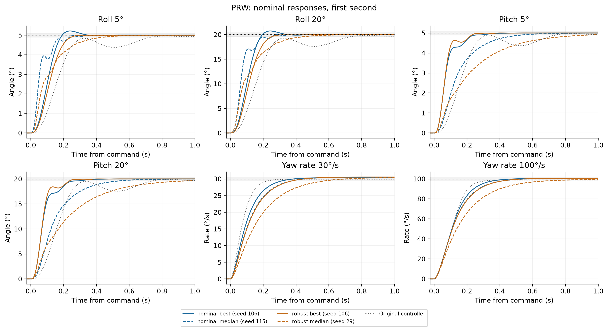
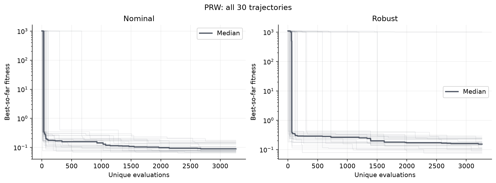
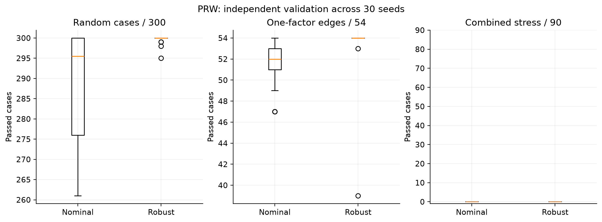

# Pure Random Walk (PRW) for quadrotor controller tuning

**Author: Mohammad ALbaraj** · [Project overview](../README.md) · [Shared model and objective](../docs/METHODOLOGY.md)

## Purpose

Tune eight bounded roll/pitch and yaw-rate controller parameters offline. The optimizer changes gains; it does not change the plant equations, controller structure, or constraints. Lower constrained fitness is better within the same training regime.

## How this implementation works

PRW is a deliberately simple exploration baseline with constant proposal length.

1. Start from the best common initial candidate.
2. Draw an independent random unit direction and propose a fixed-length move.
3. Reflect the new point into [0, 1].
4. Always accept the new current point, regardless of whether its fitness improves.
5. Separately retain the best evaluated point and return that archive when 3,264 unique evaluations have been consumed.

There is no greedy acceptance, adaptive step schedule, or restart rule. The proposal length is constant before reflection; actual displacement can be shorter near a boundary. A good best-visited point does not mean the final current point is good.

Read [methods.py](methods.py) for the implemented update rules, [config.json](config.json) for settings, and [study.py](study.py) for objective evaluation.

## Protocol and selected settings

Each regime has 30 main seeds: 11, 29, 47, and 101–127. Every run receives 3,264 unique objective evaluations, including the same 64 initial points. Duplicate normalized coordinates rounded to 13 decimals are cached and do not spend the budget. The best evaluated point remains valid even when the budget interrupts a final state update.

Four candidate settings were compared on development seeds 5011, 5021, and 5039 under both nominal and robust training (24 development runs per method). The lowest average within-block rank selected one setting for both regimes. Main-seed and held-out validation results were not used for that selection.

| Selected parameter | Value |
| --- | --- |
| step | 0.12 |

## Saved 30-seed results

| Regime | Best | Median | Mean | Sample SD | Training-feasible runs |
| --- | --- | --- | --- | --- | --- |
| nominal | 0.063881674 | 0.089606718 | 0.10209083 | 0.034357144 | 30/30 |
| robust | 0.075969036 | 0.15397958 | 34.107374 | 185.93485 | 29/30 |

Source: [fitness_summary.csv](results/fitness_summary.csv). Infeasible runs have penalized scores above 1,000 and remain in means and standard deviations. A low median does not imply every run found a feasible controller.

### Held-out validation

| Training regime | Suite | Pass range across 30 runs | Median passes |
| --- | --- | --- | --- |
| nominal | Random single-axis | 261–300 / 300 | 295.5 / 300 |
| nominal | One-factor boundaries | 47–54 / 54 | 52 / 54 |
| nominal | Combined-axis stress | 0–0 / 90 | 0 / 90 |
| robust | Random single-axis | 295–300 / 300 | 300 / 300 |
| robust | One-factor boundaries | 39–54 / 54 | 54 / 54 |
| robust | Combined-axis stress | 0–0 / 90 | 0 / 90 |

Source: [validation_summary.csv](results/validation_summary.csv). These are repeated checks on fixed test suites, not independent hardware success probabilities. Combined-axis failures remain visible.

### Training-selected representatives

| Regime | Selection | Seed | Fitness | Joint-boundary passes / 1,536 |
| --- | --- | --- | --- | --- |
| nominal | best | 106 | 0.063881674 | 1280 |
| nominal | median | 115 | 0.086669725 | 1280 |
| robust | best | 106 | 0.075969036 | 1536 |
| robust | median | 29 | 0.15146554 | 1536 |

The median representative is an actual run nearest the method median (seed breaks ties), not the median of gain coordinates. Exact gains and coefficients: [selected_candidates.csv](results/selected_candidates.csv) and [exports/](results/exports/). Boundary audits concern these selected representatives, not all seeds.

## Run and inspect

From this folder in PowerShell:

```powershell
python -m venv .venv
.\.venv\Scripts\python.exe -m pip install -r requirements-lock.txt
.\.venv\Scripts\python.exe -m unittest test_methods test_budget test_study test_robust
.\.venv\Scripts\python.exe run_method.py --processes 4 --search-only
```

The last command reuses and audits the supplied 60 completed main runs. Omit `--search-only` to execute held-out validation and regenerate method figures; this can be expensive. The runner reads [METHOD.json](METHOD.json), [results/contract.json](results/contract.json), and [results/selected_parameters.json](results/selected_parameters.json).

For an entirely new six-method experiment, use `run_extension.py --processes 6` in a separate clean copy; it runs development selection and main searches for all six methods. Central analysis scripts expect all six methods together, whereas this delivered folder contains only its own method runs. Do not confuse the central 360-run audit metadata with the 60 runs packaged in this folder.

## Result files

| Path | Meaning |
| --- | --- |
| [fitness_summary.csv](results/fitness_summary.csv) | Fitness distribution and confidence intervals |
| [parameter_selection.csv](results/parameter_selection.csv) | Development-grid selection |
| [nominal/runs/](results/nominal/runs/) | 30 nominal run records and evaluation ledgers |
| [robust/runs/](results/robust/runs/) | 30 robust run records and evaluation ledgers |
| [validation/](results/validation/) | Compressed scenario-level validation data |
| [plot_data/](results/plot_data/) | Numerical inputs behind the figures |
| [statistics.json](results/statistics.json) | Statistical design and comparison caveats |
| [reference_benchmark/](reference_benchmark/) | Frozen five-method comparison inputs |

## Figures







### Complete figure index

- [01 fitness distributions](results/plots/01_fitness_distributions.png)
- [02 convergence](results/plots/02_convergence.png)
- [03 validation passes](results/plots/03_validation_passes.png)
- [04 speed robustness](results/plots/04_speed_robustness.png)
- [05 parameter study](results/plots/05_parameter_study.png)
- [06 joint boundaries](results/plots/06_joint_boundaries.png)
- [07 eleven methods](results/plots/07_eleven_methods.png)
- [controller](results/plots/equations/controller.png)
- [fitness](results/plots/equations/fitness.png)
- [plant](results/plots/equations/plant.png)
- [01 responses](results/plots/PRW/01_responses.png)
- [02 convergence](results/plots/PRW/02_convergence.png)
- [03 uncertain responses](results/plots/PRW/03_uncertain_responses.png)
- [04 actuation](results/plots/PRW/04_actuation.png)
- [05 validation](results/plots/PRW/05_validation.png)
- [06 sensitivity](results/plots/PRW/06_sensitivity.png)
- [07 full responses](results/plots/PRW/07_full_responses.png)

## Limits and provenance

The files are saved simulation outputs from the supplied project, not new flight tests. Packaging checks and unit tests do not independently rerun the full optimization campaigns. The six newer methods received a development grid that the original five did not; an eleven-method comparison is exploratory even with equal final budgets. Controller timing is assumed at 1 ms and mixer timing at 4 ms. Negative motor speeds are rejected under the preserved source motor equation. Position/altitude control and hardware robustness are outside this study.

See [shared methodology](../docs/METHODOLOGY.md) and [data provenance](../docs/DATA.md). Please cite Mohammad ALbaraj using [CITATION.cff](../CITATION.cff). No reuse license has yet been selected.
